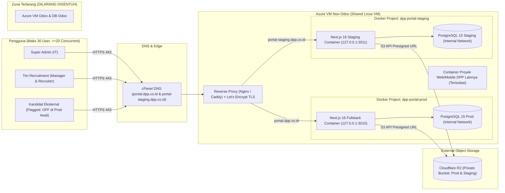
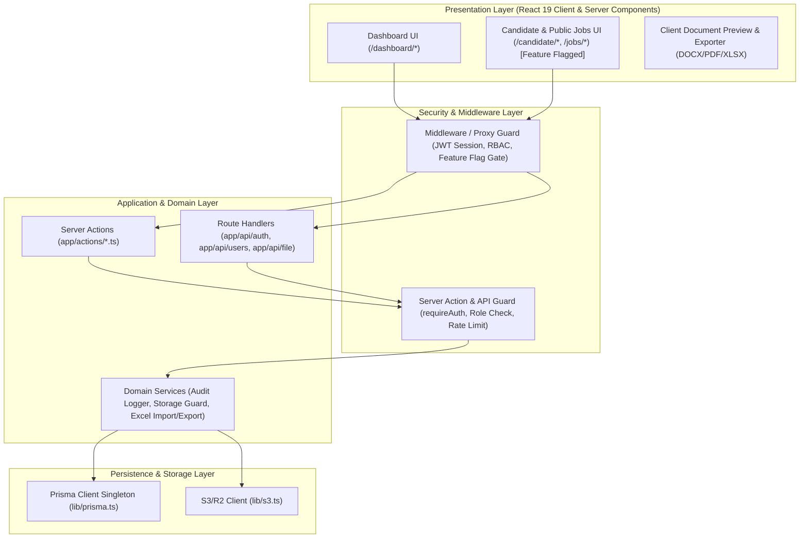
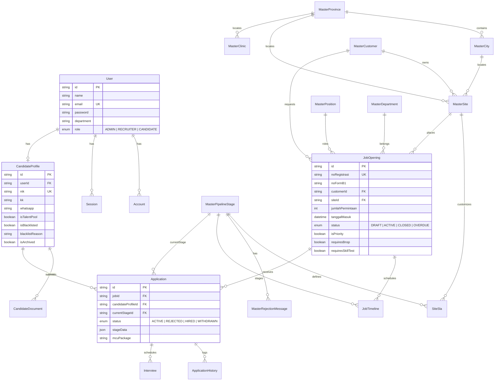

# Dokumentasi Arsitektur — DPP Recruitment Portal Dashboard

Dokumen ini menjelaskan arsitektur aplikasi, topologi infrastruktur pada VM Azure non-Odoo, alur keamanan & penyimpanan objek Cloudflare R2, serta Entity-Relationship Diagram (ERD).

---

## 1. Konteks Sistem & Batasan Integrasi

> [!IMPORTANT]
> **Batasan Mutlak:** Sistem ini berdiri sendiri (*standalone*) dan merupakan *System of Record* untuk seluruh proses rekrutmen PT Dian Pandu Pratama (DPP). Sistem ini **TIDAK** terhubung ke VM maupun database Odoo dalam bentuk apa pun.



---

## 2. Arsitektur Lapisan Aplikasi (Next.js 16 App Router)

Aplikasi menggunakan pola **Modular Fullstack Monolith** di atas Next.js 16.2:



### Struktur Direktori Eksisting (Dipertahankan Selama Knowledge Transfer)
- `app/dashboard/*`: Seluruh halaman operasional internal (Executive, Reports, GeoSource, Job Openings, Pipeline 10 tahap, Talent Pool, Interviews, Calendar, Blacklist, Archived, Generate Documents, Settings Master Data, SLA, Users).
- `app/candidate/*` & `app/jobs/*`: Portal kandidat & lowongan publik (dikontrol via *feature flag* `FEATURE_CANDIDATE_PORTAL` dan `FEATURE_PUBLIC_JOBS`).
- `app/actions/*`: Server Actions (`job.ts`, `candidate-profile.ts`, `candidate-application.ts`, `master-data.ts`, `dashboard.ts`, `document.ts`, `upload.ts`).
- `app/api/*`: Route handlers (`auth/[...nextauth]`, `auth/register`, `users`, `users/[id]`, `file`).
- `lib/*`: Konfigurasi `auth.ts`, `prisma.ts`, `s3.ts`, `document-generator.ts`, `mcu-clinics.ts`, `validations/*`.
- `prisma/`: `schema.prisma`, `migrations/`, `seed-essential.ts`, `seed-dummy.ts`.

---

## 3. Alur Keamanan Dokumen (Cloudflare R2 Presigned URL)

Untuk menjaga beban RAM/CPU VM tetap rendah sekaligus mematuhi UU PDP, file tidak melewati memori container Next.js secara terus-menerus, melainkan menggunakan *presigned URL* berumur pendek dengan pemeriksaan otorisasi ketat:

```mermaid
sequenceDiagram
    autonumber
    actor User as Recruiter / Candidate
    participant App as Next.js Server (Action / API)
    participant DB as PostgreSQL (Prisma)
    participant R2 as Cloudflare R2 (Private Bucket)

    Note over User,R2: Alur Upload Dokumen
    User->>App: Request Upload URL (fileName, mimeType, sizeBytes, docType)
    App->>App: Verifikasi Session, Role & Validasi Tipe (PDF/JPG/PNG) + Ukuran (<=5MB)
    App->>App: Bangun objectKey di Server (tidak percaya path dari client)
    App->>R2: Sign PutObjectCommand (expiresIn: 900s)
    R2-->>App: Presigned PUT URL
    App-->>User: Return { uploadUrl, objectKey }
    User->>R2: HTTP PUT file binary langsung ke R2
    User->>App: Konfirmasi metadata dokumen
    App->>DB: Simpan CandidateDocument & AuditLog

    Note over User,R2: Alur Download / Preview Dokumen (/api/file?key=...)
    User->>App: GET /api/file?key=candidates/xyz/cv.pdf
    App->>DB: Cek Session + Kepemilikan Dokumen / Role Internal
    alt Tidak Berhak (Unauthorized / IDOR)
        App-->>User: HTTP 403 Forbidden
    else Berhak
        App->>DB: Catat AuditLog (VIEW_DOCUMENT)
        App->>R2: Sign GetObjectCommand (expiresIn: 300s)
        App-->>User: HTTP 302 Redirect ke Presigned GET URL
    end
```



---

## 4. Model Data (ERD)

### 4.1 ERD Saat Ini (22 Model di `prisma/schema.prisma`)
Seluruh primary key saat ini menggunakan `@id @default(cuid())` yang sudah bersifat unik dan stabil.



### 4.2 Penambahan Model Minimal untuk Target Produksi (Non-Breaking)
Untuk memenuhi kebutuhan Audit Log (§4.9 & §8 Brief) tanpa merusak skema developer saat ini, hanya diperlukan penambahan 1 tabel mandiri `AuditLog` (dan opsional kolom `mustChangePassword` pada `User`) pada Fase 2 pasca-KT:

```prisma
model AuditLog {
  id          String   @id @default(cuid())
  actorId     String?
  actorEmail  String?
  actorRole   String?
  action      String   // e.g. USER_CREATED, PASSWORD_RESET, STAGE_MOVED, FILE_DOWNLOADED
  entityType  String   // e.g. User, JobOpening, Application, CandidateDocument
  entityId    String?
  metadata    Json?    // Ringkasan perubahan (tanpa data rahasia/password)
  ipAddress   String?
  userAgent   String?
  createdAt   DateTime @default(now())

  @@index([actorId])
  @@index([entityType, entityId])
  @@index([createdAt])
}
```

---

## 5. Desain Konfigurasi Environment & Fleksibilitas Subdomain

Agar perubahan domain/subdomain di masa depan (`portal.dpp.co.id`, `portal-staging.dpp.co.id`, atau nama baru) tidak memerlukan perubahan kode, seluruh referensi URL dan fitur dikendalikan lewat variabel environment:

| Variabel Environment | Nilai Lokal (`.env`) | Nilai Staging | Nilai Production |
|---|---|---|---|
| `NEXTAUTH_URL` | `http://localhost:3000` | `https://portal-staging.dpp.co.id` | `https://portal.dpp.co.id` |
| `FEATURE_CANDIDATE_PORTAL` | `true` | `false` (tahap awal) | `false` (tahap awal) |
| `FEATURE_PUBLIC_JOBS` | `true` | `false` (tahap awal) | `false` (tahap awal) |
| `S3_ENDPOINT` | `http://localhost:9000` (atau R2 dev) | `https://<acct>.r2.cloudflarestorage.com` | `https://<acct>.r2.cloudflarestorage.com` |
| `S3_BUCKET_NAME` | `recruitment-bucket` | `dpp-recruitment-staging` | `dpp-recruitment-prod` |
| `S3_REGION` | `us-east-1` | `auto` | `auto` |

